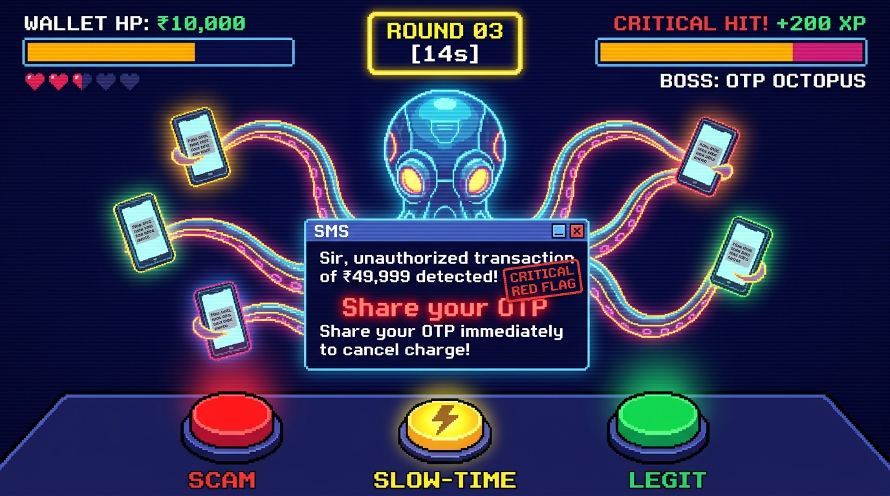
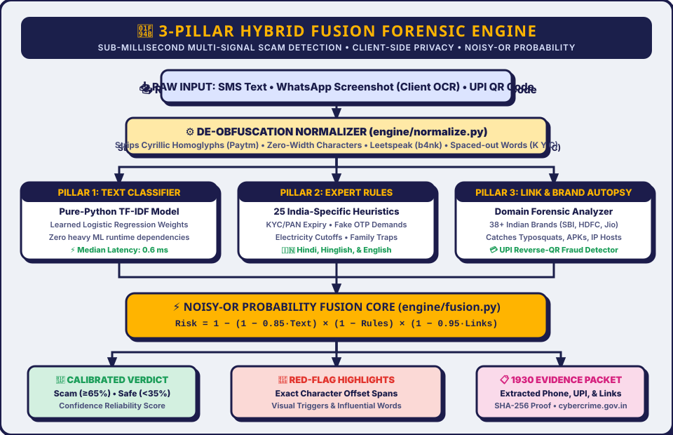

<div align="center">


# 🥋 SCAMDOJO
### *Spot the scam before it spots your wallet.*

An arcade-infused cyber defense training dojo and sub-millisecond AI forensic engine designed specifically for Indian digital fraud vectors (SMS, WhatsApp, fake KYC notices, and malicious UPI payment QR codes).

[](https://scamdojo.onrender.com)
[](https://github.com/Saamia18/ScamDojo)
[](https://scamdojo.onrender.com/#/hood)
[](https://python.org)
[](https://scamdojo.onrender.com/#/protect)

<br/>

[🕹️ Play Live Demo](https://scamdojo.onrender.com) • [🎮 Game Modes](#-cyber-dojo-game-modes) • [🛡️ AI Forensic Engine](#-the-forensic-ai-engine) • [📊 Battle Benchmarks](#-battle-metrics--calibration) • [🚀 Quickstart](#-quickstart-arcade-setup) • [📜 1930 Incident Reporting](#-1930--cybercrimegovin-evidence-packet)

</div>

---

## 🕹️ Live Arcade Demo

Test the live application right now in your browser:
👉 **[https://scamdojo.onrender.com](https://scamdojo.onrender.com)**

> **Pro-Tip:** Open the link on two different phones or browser windows to challenge a friend in **Live 1v1 Multiplayer Duels** over WebSockets!

---

## 🎮 Cyber Dojo: Game Modes

ScamDojo bridges forensic cybersecurity with retro-arcade mechanics. Rather than reading boring bullet points, players build muscle memory by fighting bosses and racing against AI clocks.

<div align="center">
  
</div>

### 1. 🐙 Boss Rush (`/#/play`)
Defend your **₹10,000 virtual wallet** against 5 notorious Indian fraud archetypes. Tapping suspected red-flag phrases directly on the card scores **Critical Hits**!
* 🐙 **KYC Kraken:** Urgent bank account suspension & pan-card deactivation threats.
* 🦙 **Lottery Llama:** Fake KBC / Jio Diwali bumper lottery winnings requiring "processing taxes".
* 🐙 **OTP Octopus:** High-pressure "fraud squad" bank executives demanding instant OTPs.
* 🐺 **Job Offer Jackal:** Work-from-home YouTube like / Telegram daily task schemes.
* 🐍 **Courier Cobra:** Customs hold fees and India Post address re-delivery traps.
* **Power-Ups:** Use **Hint** to illuminate suspicious links or **Slow-Time** to freeze the ticking card timer.

<div align="center">
  
</div>

### 2. ⚔️ Beat the AI — Red-Flag Race (`/#/duel`)
Human vs. Machine speedrun. You and ScamDojo's real-time inference engine hunt the same message simultaneously.
* Tap scam triggers before the AI schedule claims them (**+2 pts**).
* Tap harmless innocent words and get penalized (**-1 pt**).
* Accurately spot legitimate messages by hitting **"Looks clean"**.

### 3. 👥 Live 1v1 Multiplayer Duels (`/#/duel/live`)
Real-time, cross-device multiplayer powered by **WebSockets**.
* **Room Matchmaking:** Generate a 4-character room code (e.g., `H7KP`) and share it with a friend on any phone or laptop.
* **Authoritative Clock:** Server-synchronized 3-second countdown and 20-second rounds.
* **First-to-Claim Mechanics:** Whoever taps a red flag first locks it on both screens.
* **Smart Bot Fallback:** If nobody joins within 2 minutes (or an opponent leaves mid-match), an AI bot steps in automatically.

### 4. ⚡ Inbox Rush (`/#/rush`)
Endless triage mode. Fast-paced survival where every correct swipe adds points, but the round countdown timer progressively shrinks from 12 seconds down to a punishing 5 seconds!

### 5. 📅 Scam of the Day & Adaptive Difficulty (`/#/daily`)
Daily challenge to maintain your dojo streak. The engine tracks missed categories on your **Progress** tab and automatically feeds your personal weak spots more frequently.

---

## 🛡️ The Forensic AI Engine

ScamDojo operates on a **3-Pillar Hybrid Fusion Architecture** operating at **0.6 ms median latency** with zero external heavy ML dependencies.

<div align="center">
  
</div>

### Forensic Pillars:
1. **De-Obfuscation Normalizer (`engine/normalize.py`):** Unravels evasion tricks like Cyrillic homoglyphs (`Раytm`), leetspeak (`b4nk`), zero-width Unicode characters, and spaced-out keywords (`K Y C`) while preserving original character offsets for UI rendering.
2. **Text Model (`engine/textclf.py`):** Pure-Python logistic regression model without PyTorch/Scikit-learn bloat. Every word holds a learned weight, allowing the UI to display exactly which words tilted the score.
3. **25 India Heuristic Rules (`engine/rules.py`):** Context-aware triggers for colloquial Hindi, Hinglish, and English. Differentiates bank safety warnings (*"Never share your OTP"*) from active fraud demands (*"Share OTP to avoid block"*).
4. **Link Autopsy (`engine/urlcheck.py`):** Recognizes 38+ Indian financial brands (SBI, HDFC, ICICI, India Post, Jio, PhonePe, Paytm). Catches typosquats (`sbi-kyc-update.xyz`), lookalike subdomains (`hdfcbank.com.verify-now.top`), raw IP hosts, and `.apk` downloads while whitelisting official portals (`*.gov.in`, `sbi.co.in`).
5. **UPI Reverse-QR Detection (`engine/upi.py`):** Flags `upi://pay` strings where victims expecting to *receive* money are lured into authorizing a *debit* transaction.

---

## 🔒 100% Client-Side Privacy

* **Zero-Knowledge OCR & QR:** Screenshot text extraction (Tesseract.js) and QR barcode decoding (native `BarcodeDetector` / jsQR) execute **100% locally inside the browser**. Images are **never** uploaded or sent to any server.
* **Zero Message Retention:** Pasted SMS text and scanned parameters are evaluated in-memory and never written to logs or disk.
* **Anonymous Accounts:** Optional user accounts use `scrypt` hashing with single-use cryptographic recovery codes. No email, phone number, or KYC required.

---

## 📜 1930 / Cybercrime.gov.in Evidence Packet

When a scam is detected, ScamDojo automatically extracts forensic Indicators of Compromise (IoCs) and compiles an instant, ready-to-file complaint brief:
* **Extracted Entities:** Phone numbers, suspicious URLs, UPI IDs, IFSC codes, timestamps, and demanded amounts.
* **Cryptographic Proof:** Calculates a SHA-256 fingerprint of the raw message.
* **Printable Output:** One-click copy for the **1930 helpline** or printable PDF formatted to match the [cybercrime.gov.in](https://cybercrime.gov.in) submission schema.

---

## 📊 Battle Metrics & Calibration

Every metric is empirically derived by `engine/train.py` across real evaluation sets (not hand-typed):

| Test Evaluation Set | Messages | Focus Area | Fused F1 | Text-Only F1 |
|:---|:---:|:---|:---:|:---:|
| **Unseen Templates** | 240 | New template variants | **1.00** | 1.00 |
| **Dev Benchmark** | 137 | Hand-written tuning set | **1.00** | 0.96 |
| **Blind Test Set** | 60 | Frozen unseen realistic messages | **0.86** | 0.88 |
| **Game Deck Cards** | 55 | In-game scam and legit scenarios | **0.96** | 0.96 |

* **Speed:** 0.5 ms median latency (~1,400 messages/second on a single Python thread).
* **Link Benchmark:** 1.00 precision and 0.89 recall across 94 phishing & official domains with zero false alarms on legitimate brand links.
* **Multilingual UI:** Complete interface, audio narration, and game decks in **English**, **Hindi (हिंदी)**, and **Kannada (ಕನ್ನಡ)**.

---

## 🚀 Quickstart: Arcade Setup

### 1. Clone & Run Locally
```bash
# Clone the repository
git clone https://github.com/Saamia18/ScamDojo.git
cd ScamDojo

# Install dependencies (Flask & WebSockets)
pip install -r requirements.txt

# Launch development server
python server.py
```
Open **`http://localhost:8000`** in your browser.

### 2. Run the 55 Automated Unit Tests
```bash
python -m unittest discover -s tests -v
```

### 3. Re-train & Benchmark Engine
```bash
python -m engine.train          # Retrains model & updates metrics.json
python scripts/build_cards.py   # Recompiles game deck cards
python scripts/build_offline.py # Generates client-side PWA offline rules
```

---

## 🌐 Production Cloud Deployment

The repository includes ready-to-deploy configs for **Render**, **Railway**, or any Linux container:
* **`Procfile`**: Starts high-performance Gunicorn server with threaded WebSockets:
  ```bash
  gunicorn server:app -c gunicorn.conf.py
  ```
* **`render.yaml`**: Pre-configured Infrastructure-as-Code for 1-click Render web service deployment.
* **WebSocket Port Unification:** Uses `flask-sock` on port 8000 (with built-in RFC 6455 fallback for local Windows dev).

---

## 🛠️ The Tech Stack

```text
Frontend   : Vanilla ES Modules (Zero build step), Neobrutalist CSS, Web Audio API, Web Speech API
Backend    : Python 3.12+, Flask 3.1, Gunicorn (threaded worker model)
Networking : WebSockets (RFC 6455 via flask-sock / simple-websocket)
Forensics  : Pure-Python TF-IDF, Regex Entities, Tesseract.js (Client OCR), jsQR
Storage    : SQLite3 (scrypt hashing, zero text logging)
Offline    : Progressive Web App (PWA), Service Worker (sw.js) cache-first
```

---

<div align="center">

### 🥋 Built with precision. Defend your wallet.

**[🎮 Launch ScamDojo Online](https://scamdojo.onrender.com)**

</div>
