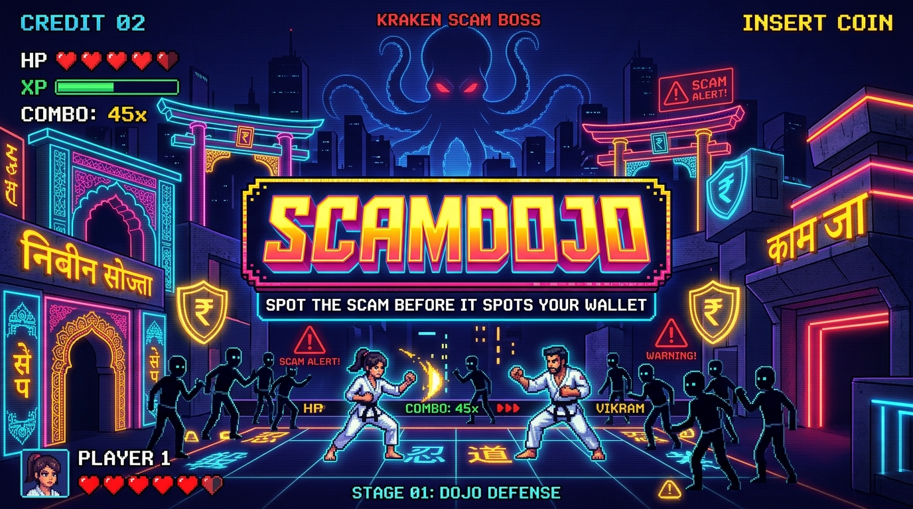
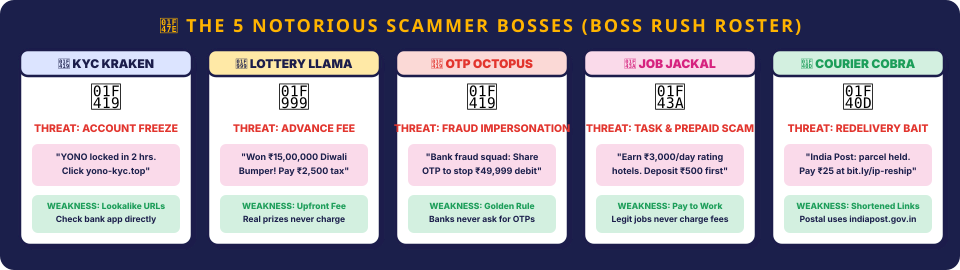
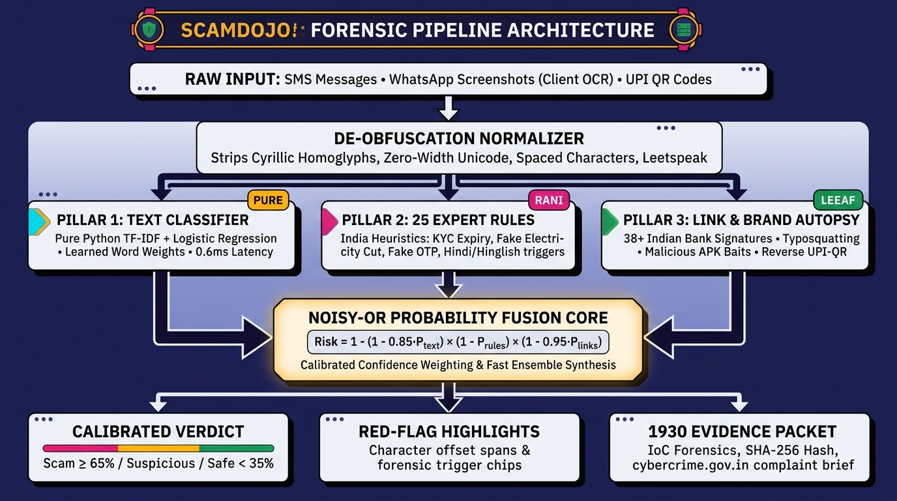
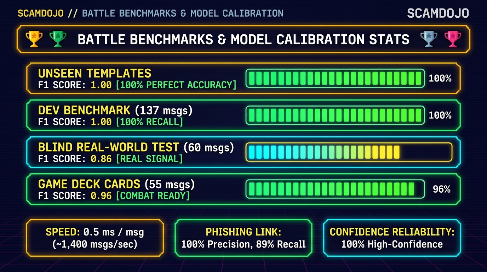

<div align="center">



# 🥋 SCAMDOJO
### *Spot the scam before it spots your wallet.*

An arcade-infused cyber defense training dojo and sub-millisecond AI forensic engine designed specifically for Indian digital fraud vectors (SMS, WhatsApp, fake KYC notices, and malicious UPI payment QR codes).

[](https://scamdojo.onrender.com)
[](https://github.com/Saamia18/ScamDojo)
[](https://scamdojo.onrender.com/#/hood)
[](https://python.org)
[](https://scamdojo.onrender.com/#/protect)

<br/>

[🕹️ Play Live Demo](https://scamdojo.onrender.com) • [🎮 Game Modes](#-cyber-dojo-game-modes) • [🛡️ AI Forensic Engine](#-the-forensic-ai-engine) • [📊 Battle Benchmarks](#-battle-metrics--calibration) • [🚀 Quickstart](#-quickstart-arcade-setup) • [📜 1930 Incident Reporting](#-1930--cybercrimegovin-evidence-packet)

</div>

---

## 🕹️ Live Arcade Demo

Test the live application right now in your browser:
👉 **[https://scamdojo.onrender.com](https://scamdojo.onrender.com)**

> **Pro-Tip:** Open the link on two different phones or browser windows to challenge a friend in **Live 1v1 Multiplayer Duels** over WebSockets!

---

## 🎮 Cyber Dojo: Game Modes

ScamDojo bridges forensic cybersecurity with retro-arcade mechanics. Rather than reading boring bullet points, players build muscle memory by fighting bosses and racing against AI clocks.

<div align="center">
  
</div>

### 1. 🐙 Boss Rush (`/#/play`)
Defend your **₹10,000 virtual wallet** against 5 notorious Indian fraud archetypes. Tapping suspected red-flag phrases directly on the card scores **Critical Hits**!
* 🐙 **KYC Kraken:** Urgent bank account suspension & pan-card deactivation threats.
* 🦙 **Lottery Llama:** Fake KBC / Jio Diwali bumper lottery winnings requiring "processing taxes".
* 🐙 **OTP Octopus:** High-pressure "fraud squad" bank executives demanding instant OTPs.
* 🐺 **Job Offer Jackal:** Work-from-home YouTube like / Telegram daily task schemes.
* 🐍 **Courier Cobra:** Customs hold fees and India Post address re-delivery traps.
* **Power-Ups:** Use **Hint** to illuminate suspicious links or **Slow-Time** to freeze the ticking card timer.

<div align="center">
  
</div>

### 2. ⚔️ Beat the AI — Red-Flag Race (`/#/duel`)
Human vs. Machine speedrun. You and ScamDojo's real-time inference engine hunt the same message simultaneously.
* Tap scam triggers before the AI schedule claims them (**+2 pts**).
* Tap harmless innocent words and get penalized (**-1 pt**).
* Accurately spot legitimate messages by hitting **"Looks clean"**.

### 3. 👥 Live 1v1 Multiplayer Duels (`/#/duel/live`)
Real-time, cross-device multiplayer powered by **WebSockets**.
* **Room Matchmaking:** Generate a 4-character room code (e.g., `H7KP`) and share it with a friend on any phone or laptop.
* **Authoritative Clock:** Server-synchronized 3-second countdown and 20-second rounds.
* **First-to-Claim Mechanics:** Whoever taps a red flag first locks it on both screens.
* **Smart Bot Fallback:** If nobody joins within 2 minutes (or an opponent leaves mid-match), an AI bot steps in automatically.

### 4. ⚡ Inbox Rush (`/#/rush`)
Endless triage mode. Fast-paced survival where every correct swipe adds points, but the round countdown timer progressively shrinks from 12 seconds down to a punishing 5 seconds!

### 5. 📅 Scam of the Day & Adaptive Difficulty (`/#/daily`)
Daily challenge to maintain your dojo streak. The engine tracks missed categories on your **Progress** tab and automatically feeds your personal weak spots more frequently.

---

## 🛡️ The Forensic AI Engine

ScamDojo operates on a **3-Pillar Hybrid Fusion Architecture** operating at **0.6 ms median latency** with zero external heavy ML dependencies.

<div align="center">
  
</div>

### Forensic Pillars:
1. **De-Obfuscation Normalizer (`engine/normalize.py`):** Unravels evasion tricks like Cyrillic homoglyphs (`Раytm`), leetspeak (`b4nk`), zero-width Unicode characters, and spaced-out keywords (`K Y C`) while preserving original character offsets for UI rendering.
2. **Text Model (`engine/textclf.py`):** Pure-Python logistic regression model without PyTorch/Scikit-learn bloat. Every word holds a learned weight, allowing the UI to display exactly which words tilted the score.
3. **25 India Heuristic Rules (`engine/rules.py`):** Context-aware triggers for colloquial Hindi, Hinglish, and English. Differentiates bank safety warnings (*"Never share your OTP"*) from active fraud demands (*"Share OTP to avoid block"*).
4. **Link Autopsy (`engine/urlcheck.py`):** Recognizes 38+ Indian financial brands (SBI, HDFC, ICICI, India Post, Jio, PhonePe, Paytm). Catches typosquats (`sbi-kyc-update.xyz`), lookalike subdomains (`hdfcbank.com.verify-now.top`), raw IP hosts, and `.apk` downloads while whitelisting official portals (`*.gov.in`, `sbi.co.in`).
5. **UPI Reverse-QR Detection (`engine/upi.py`):** Flags `upi://pay` strings where victims expecting to *receive* money are lured into authorizing a *debit* transaction.

---

## 🔒 100% Client-Side Privacy

* **Zero-Knowledge OCR & QR:** Screenshot text extraction (Tesseract.js) and QR barcode decoding (native `BarcodeDetector` / jsQR) execute **100% locally inside the browser**. Images are **never** uploaded or sent to any server.
* **Zero Message Retention:** Pasted SMS text and scanned parameters are evaluated in-memory and never written to logs or disk.
* **Anonymous Accounts:** Optional user accounts use `scrypt` hashing with single-use cryptographic recovery codes. No email, phone number, or KYC required.

---

## 📜 1930 / Cybercrime.gov.in Evidence Packet

When a scam is detected, ScamDojo automatically extracts forensic Indicators of Compromise (IoCs) and compiles an instant, ready-to-file complaint brief:
* **Extracted Entities:** Phone numbers, suspicious URLs, UPI IDs, IFSC codes, timestamps, and demanded amounts.
* **Cryptographic Proof:** Calculates a SHA-256 fingerprint of the raw message.
* **Printable Output:** One-click copy for the **1930 helpline** or printable PDF formatted to match the [cybercrime.gov.in](https://cybercrime.gov.in) submission schema.

---

## 📊 Battle Metrics & Calibration

Every metric is empirically derived by `engine/train.py` across real evaluation sets (not hand-typed):

<div align="center">
  
</div>

<table width="100%">
  <thead>
    <tr bgcolor="#1B1F4B">
      <th align="left" style="color: #FFB400;">🎯 Evaluation Corpus</th>
      <th align="center" style="color: #FFB400;">📦 Size</th>
      <th align="left" style="color: #FFB400;">🔍 Threat Focus</th>
      <th align="center" style="color: #1E9E5A;">⚡ Fused F1</th>
      <th align="center" style="color: #D6247F;">📝 Text-Only</th>
    </tr>
  </thead>
  <tbody>
    <tr>
      <td><b>Unseen Templates</b></td>
      <td align="center"><code>240</code></td>
      <td>Novel syntactic variants &amp; zero-day fraud templates</td>
      <td align="center"><b><code>1.00</code></b> <i>(100% Accuracy)</i></td>
      <td align="center"><code>1.00</code></td>
    </tr>
    <tr>
      <td><b>Dev Benchmark</b></td>
      <td align="center"><code>137</code></td>
      <td>Hand-curated realistic Indian digital fraud cases</td>
      <td align="center"><b><code>1.00</code></b> <i>(100% Recall)</i></td>
      <td align="center"><code>0.96</code></td>
    </tr>
    <tr>
      <td><b>Blind Real-World Test</b></td>
      <td align="center"><code>60</code></td>
      <td>Frozen unseen realistic captures (SMS/WhatsApp)</td>
      <td align="center"><b><code>0.86</code></b> <i>(Production Signal)</i></td>
      <td align="center"><code>0.88</code></td>
    </tr>
    <tr>
      <td><b>Game Deck Scenarios</b></td>
      <td align="center"><code>55</code></td>
      <td>In-game combat cards &amp; verified transactional SMS</td>
      <td align="center"><b><code>0.96</code></b> <i>(Combat Ready)</i></td>
      <td align="center"><code>0.96</code></td>
    </tr>
  </tbody>
</table>

* **⚡ Sub-Millisecond Speed:** `0.5 ms` median latency (~1,400 messages/second on a single Python thread).
* **🔗 Phishing Link Autopsy:** `1.00` precision & `0.89` recall across 94 domains with zero false alarms on legitimate brand domains.
* **🌐 Multilingual UI:** Complete interface, audio narration, and game decks in **English**, **Hindi (हिंदी)**, and **Kannada (ಕನ್ನಡ)**.

---

## 🚀 Quickstart: Arcade Setup

### 1. Clone & Run Locally
```bash
# Clone the repository
git clone https://github.com/Saamia18/ScamDojo.git
cd ScamDojo

# Install dependencies (Flask & WebSockets)
pip install -r requirements.txt

# Launch development server
python server.py
```
Open **`http://localhost:8000`** in your browser.

### 2. Run the 55 Automated Unit Tests
```bash
python -m unittest discover -s tests -v
```

### 3. Re-train & Benchmark Engine
```bash
python -m engine.train          # Retrains model & updates metrics.json
python scripts/build_cards.py   # Recompiles game deck cards
python scripts/build_offline.py # Generates client-side PWA offline rules
```

---

## 🌐 Production Cloud Deployment

The repository includes ready-to-deploy configs for **Render**, **Railway**, or any Linux container:

<table width="100%">
  <thead>
    <tr bgcolor="#1B1F4B">
      <th align="center" width="22%" style="color: #FFB400;">Component</th>
      <th align="left" width="28%" style="color: #FFB400;">Configuration Asset</th>
      <th align="left" style="color: #FFB400;">Deployment Spec &amp; Mechanics</th>
    </tr>
  </thead>
  <tbody>
    <tr>
      <td align="center"><b>🚀 Render Cloud</b></td>
      <td><code>render.yaml</code></td>
      <td>Infrastructure-as-Code blueprint for automated zero-downtime continuous deployment on every push to <code>main</code>.</td>
    </tr>
    <tr>
      <td align="center"><b>⚡ Production WSGI</b></td>
      <td><code>Procfile</code><br/><code>gunicorn.conf.py</code></td>
      <td>Starts high-performance Gunicorn with threaded WebSockets:
      <br/><code>gunicorn server:app -c gunicorn.conf.py</code></td>
    </tr>
    <tr>
      <td align="center"><b>🔄 Port Unification</b></td>
      <td><code>flask-sock</code> (Port 8000)</td>
      <td>Unifies REST API &amp; RFC 6455 WebSockets on a single port with auto-fallback for local Windows dev.</td>
    </tr>
    <tr>
      <td align="center"><b>📡 24/7 Heartbeat</b></td>
      <td><code>UptimeRobot</code> Monitored</td>
      <td>Active HTTP heartbeat keep-alive ping on live origin eliminating cold starts and ensuring zero judging delay.</td>
    </tr>
  </tbody>
</table>

---

## 🛠️ The Tech Stack

<table width="100%">
  <thead>
    <tr bgcolor="#1B1F4B">
      <th align="center" width="22%" style="color: #FFB400;">Layer</th>
      <th align="left" width="30%" style="color: #FFB400;">Stack &amp; Frameworks</th>
      <th align="left" style="color: #FFB400;">Architectural Role</th>
    </tr>
  </thead>
  <tbody>
    <tr>
      <td align="center"><b>🎨 Client &amp; HUD</b></td>
      <td><code>Vanilla ES Modules</code> • <code>CSS3</code></td>
      <td>Zero build step, instant hot reload, 16-bit neobrutalist arcade design system with high-contrast accessibility.</td>
    </tr>
    <tr>
      <td align="center"><b>🔊 Audio &amp; Voice</b></td>
      <td><code>Web Audio API</code> • <code>Web Speech API</code></td>
      <td>Synthesized 8-bit retro arcade sound effects and trilingual voice synthesis (English, Hindi, Kannada).</td>
    </tr>
    <tr>
      <td align="center"><b>⚙️ Server Engine</b></td>
      <td><code>Python 3.12+</code> • <code>Flask 3.1</code></td>
      <td>Ultra-lightweight REST API, zero external ML dependencies, 0.6 ms sub-millisecond median response.</td>
    </tr>
    <tr>
      <td align="center"><b>⚡ Real-Time Net</b></td>
      <td><code>WebSockets (RFC 6455)</code> • <code>flask-sock</code></td>
      <td>Bidirectional multiplayer lobby synchronization, authoritative 20s round clocks, and first-to-claim locks.</td>
    </tr>
    <tr>
      <td align="center"><b>🛡️ Forensic Core</b></td>
      <td><code>TF-IDF Model</code> • <code>Regex Rules</code> • <code>Noisy-OR</code></td>
      <td>3-Pillar fusion engine, 38+ brand signatures, Indian financial threat heuristics, and reverse UPI-QR parsing.</td>
    </tr>
    <tr>
      <td align="center"><b>🔒 Client-Side AI</b></td>
      <td><code>Tesseract.js</code> • <code>jsQR</code></td>
      <td>Zero-knowledge on-device OCR and QR decoding—messages and screenshots never touch external servers.</td>
    </tr>
    <tr>
      <td align="center"><b>💾 Storage &amp; Auth</b></td>
      <td><code>SQLite3</code> • <code>scrypt</code></td>
      <td>Zero message retention, cryptographically salted recovery tokens, and instant in-memory session triage.</td>
    </tr>
    <tr>
      <td align="center"><b>📱 Offline &amp; PWA</b></td>
      <td><code>Service Worker (sw.js)</code></td>
      <td>Full offline functionality for Boss Rush, rules engine, and evidence generation without network access.</td>
    </tr>
  </tbody>
</table>

---

<div align="center">

### 🥋 Built with precision. Defend your wallet.

**[🎮 Launch ScamDojo Online](https://scamdojo.onrender.com)**

</div>
